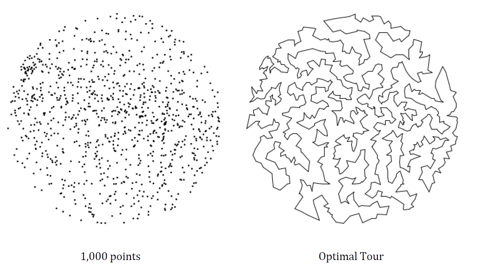
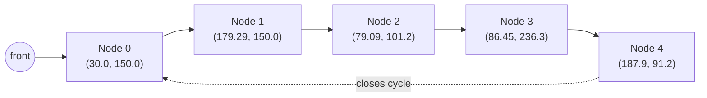
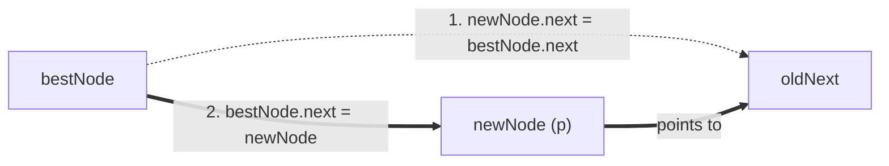
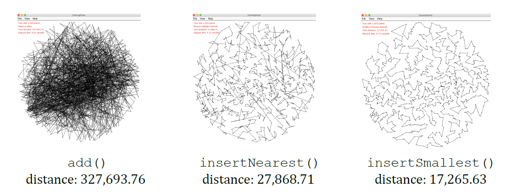

# Traveling Salesperson Problem (TSP)

*Originally developed by Robert Sedgewick and Kevin Wayne at Princeton University, and adapted by Baker Franke at the University of Chicago.*

---

## 1. Problem Overview & Perspective

Given $N$ points in the plane, the goal of a traveling salesperson is to visit every point once and return to the starting point while minimizing the total Euclidean distance traveled.

While named after a salesperson, the TSP models critical real-world optimization problems:
* Vehicle routing and delivery logistics
* Circuit board drilling and VLSI chip design
* Robotic arm motion control and machine scheduling
* X-ray crystallography and computational biology

### Why Heuristics?
In principle, you could enumerate all possible tours and select the shortest one. In practice, for $N$ points there are $N!$ orderings—even for $N = 1,000$, enumerating all tours is physically impossible. Finding an exact optimal tour for large $N$ in reasonable time remains an unsolved open problem in computer science.

Instead, computer scientists use **heuristics**—fast approximation strategies that produce high-quality (though not guaranteed optimal) tours. A **greedy heuristic** builds a tour incrementally by making the locally optimal choice at each step.


*(Left: 1,000 input points. Right: Optimal tour.)*

---

## 2. Tour Insertion Methods & Heuristics

You will represent a tour as a **circular singly-linked list** of private inner `ListNode` objects inside `Tour.java`. Each node stores a `Point` (`data`) and a reference to the next node (`next`). You will implement three ways to add a `Point` to the tour:

### A. In-Order Insertion (`add(Point p)`) — *Baseline*
Appends each new point `p` to the end of the tour in the exact order it appears in the input file (immediately before `front`). This baseline method verifies that your circular linked list structure, traversal, and drawing logic work properly.

### B. Nearest-Neighbor Heuristic (`insertNearest(Point p)`) — *Greedy Heuristic 1*
Read the next point `p`, find the existing point in the tour that is **closest** to `p`, and insert `p` immediately **after** that node.
* **Tie-breaking:** If multiple points tie for the closest distance, insert `p` after the **first** such point encountered when traversing from `front` (use `<`, not `<=`).

### C. Smallest-Increase Heuristic (`insertSmallest(Point p)`) — *Greedy Heuristic 2*
Read the next point `p` and evaluate inserting it along every existing edge `(curr, curr.next)` in the tour. Insert `p` after the node `curr` where adding `p` causes the **smallest net increase ($\Delta$)** in total tour distance:

$$\Delta = \text{dist}(\text{curr}, p) + \text{dist}(p, \text{curr.next}) - \text{dist}(\text{curr}, \text{curr.next})$$

* **Tie-breaking:** If multiple edges yield the exact same minimum increase, insert `p` after the **first** such node encountered from `front` (use `<`, not `<=`).

---

## 3. Circular Linked List Structure

Each `Tour` maintains a reference `front` to the first `ListNode` in a circular chain:



### Splicing a New Node After `bestNode`
To insert a new `ListNode` after `bestNode` in $O(1)$ pointer operations:



```java
ListNode newNode = new ListNode(p);
newNode.next = bestNode.next;
bestNode.next = newNode;
```

---

## 4. `TourInterface` Specification

Your `Tour` class must implement all methods defined in `TourInterface`:

| Method | Description |
| :--- | :--- |
| `int size()` | Returns the number of points (nodes) currently in the tour. |
| `void print()` | Traverses the tour from `front` and prints each `Point` on its own line. |
| `void draw(Graphics g)` | Draws every point and every edge (including the closing edge back to `front`) using `Graphics g`. |
| `double distance()` | Returns the total length of the tour, including the closing edge from the last node back to `front`. |
| `void add(Point p)` | Appends `p` to the end of the tour (in-order). |
| `void insertNearest(Point p)` | Inserts `p` immediately after the closest existing point. |
| `void insertSmallest(Point p)` | Inserts `p` where it causes the smallest net increase in tour length. |

---

## 5. Step-by-Step Implementation Plan

1. **Inspect Starter Files:** Open the repository in VS Code and review `Point.java`, `TourInterface.java`, `Tour.java`, and `TSPClientDriver.java` inside `src/`.
2. **Initialize `Tour` & `ListNode`:** Review the `private class ListNode` inner class inside `Tour`, declare your `front` reference, and complete the `Tour()` constructor.
3. **Implement `size()`, `add(Point p)`, and `print()`:**
   * Handle the empty tour (`front == null`) by creating a single node whose `next` pointer references itself (`front.next = front;`).
   * Use a `do { ... curr = curr.next; } while (curr != front);` loop to traverse circularly so single-node tours are visited once without infinite loops.
4. **Implement `draw(Graphics g)`:**
   * Traverse the circular list and draw each point and each segment from `curr.data` to `curr.next.data` (using `curr.data.draw(g)` and `curr.data.drawTo(curr.next.data, g)`).
   * Because `curr.next` on the last node points back to `front`, the closing segment is drawn automatically.
5. **Implement `distance()`:**
   * Return `0.0` if the tour has fewer than 2 points.
   * Sum `curr.data.distanceTo(curr.next.data)` around the entire cycle, including the final edge back to `front`.
6. **Implement `insertNearest(Point p)` and `insertSmallest(Point p)`:**
   * **Performance Warning ($O(N^2)$ vs. $O(N^3)$):** In `insertSmallest`, do **not** temporarily insert `p` and call `this.distance()` inside your loop—that produces an $O(N^3)$ algorithm that will stall on large datasets. Compute $\Delta = d(\text{curr}, p) + d(p, \text{curr.next}) - d(\text{curr}, \text{curr.next})$ in $O(1)$ time per edge.

---

## 6. Testing Workflow (Phase 1 $\rightarrow$ Phase 2)

### Phase 1: Verify `tsp5.txt` First, Then `tsp1000.txt`
Run `TSPClientDriver.main()` in VS Code. The tester enforces a **strict gate**:
1. It tests **`tsp5.txt`** across `add`, `insertNearest`, and `insertSmallest` first.
2. It verifies both the **exact point order** and **total distance**. If `tsp5.txt` is not in the exact expected order, the driver prints your actual order alongside the expected order and **stops immediately** before running `tsp1000.txt`.
3. Once `tsp5.txt` passes, it automatically advances to **`tsp1000.txt`** and opens three `DrawingPanel` windows (drag the overlapping windows apart to inspect each tour).

#### Expected Benchmark Results

| Dataset | `add()` (In-Order) | `insertNearest()` | `insertSmallest()` |
| :--- | :--- | :--- | :--- |
| **`tsp5.txt`** | `741.58` | `577.79` | `467.79` |
| **`tsp1000.txt`** | `327,693.76` | `27,868.71` | `17,265.63` |


*(Left to right: `tsp1000.txt` using `add()`, `insertNearest()`, and `insertSmallest()`.)*

---

### Phase 2: Advancing to `usa13509.txt` and `mona-1000.txt`

Before running the USA map (`usa13509.txt`) or Mona Lisa (`mona-1000.txt`), make **all three** adjustments below:

1. **Shrink the `fillOval` Circle Size (`Point.java`):**
   * By default, `g.fillOval(..., 5, 5)` draws 5×5 pixel circles. While 5×5 dots are clear on `tsp5.txt` and `tsp1000.txt`, they are **too large** for dense point clouds and will obscure the USA map and Mona Lisa picture.
   * Change the width and height in `g.fillOval(...)` from `5, 5` to **`2, 2`** (or **`1, 1`**) before running Phase 2.
2. **Comment Out the First Two Heuristics (`TSPClientDriver.java`):**
   * Comment out `add` and `insertNearest` so that **only `insertSmallest`** runs for `usa13509.txt` and `mona-1000.txt`.
3. **Use Only `mona-1000.txt`:**
   * Ignore all other Mona Lisa datasets—only run `usa13509.txt` and `mona-1000.txt`.

> **Runtime Warning:** Even with an optimal $O(N^2)$ implementation, `usa13509.txt` contains 13,509 points ($\approx 91$ million edge checks) and will take **10–45 seconds** to finish. Do **not** redraw the tour inside your insertion loop—build the complete `Tour` first, then call `draw(g)` once at the end.

---

## 7. Requirements & Live Demonstration Checklist

When you are ready to be checked off, call your instructor over to your computer and be prepared to demonstrate and explain the following:

* **Complete & Commented Code:** All `TourInterface` methods (`size`, `print`, `add`, `draw`, `distance`, `insertNearest`, `insertSmallest`) are implemented and clearly commented.
* **Phase 1 Verification (`tsp5.txt` & `tsp1000.txt`):**
  * Show that `tsp5.txt` passes the exact point-order and distance checks (`741.58`, `577.79`, and `467.79`).
  * Show the three `DrawingPanel` windows for `tsp1000.txt` (`327,693.76`, `27,868.71`, and `17,265.63`), with `insertSmallest` completing in **under 1 second** (5 seconds maximum).
* **Phase 2 Visuals (`usa13509.txt` & `mona-1000.txt`):**
  * Show that you shrank the `fillOval` size in `Point.java` (`2, 2` or `1, 1`) and commented out `add` and `insertNearest` in `TSPClientDriver.java`.
  * Display the rendered `insertSmallest` tours for both `usa13509.txt` and `mona-1000.txt`.
* **Verbal Algorithm & Big-O Walkthrough:** Both partners must be able to explain:
  1. How `insertNearest` and `insertSmallest` work step by step (including how `insertSmallest` computes $\Delta$ in $O(1)$ time per edge).
  2. The Big-O time complexity of inserting a single point and building an entire $N$-point tour for both heuristics.